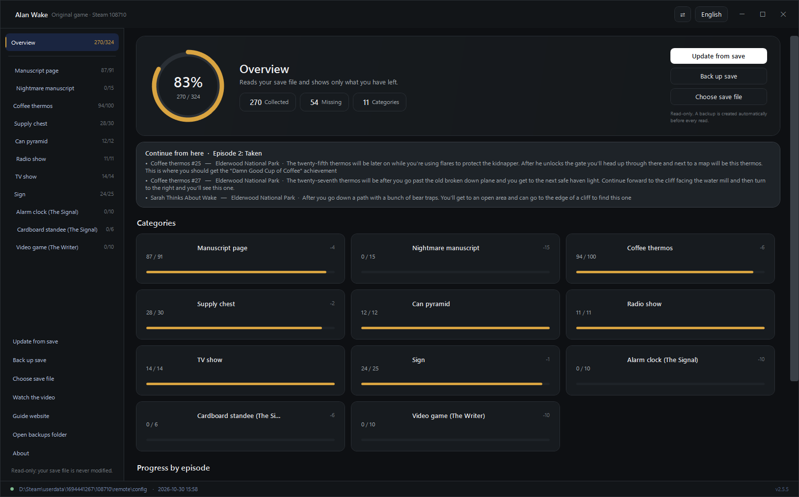

# Alan Wake Collectible Tracker 2.6.6

A portable Windows program that reads your **Alan Wake** and **Alan Wake's American Nightmare** save files and shows exactly which collectibles you are still missing — with location descriptions, screenshots, and per-episode progress.

- **Native desktop app** (WPF, .NET Framework 4.8) — no browser, no server, no installer.
- **Read-only** — your save is never written to. A dated backup is made before the first read.
- **8 languages**, including full right-to-left Arabic.



---

## Features

- **Game chooser and profile chooser** — every detected save (Steam, Epic, GOG, Microsoft Store, Documents) with account name, path, date and progress.
- **Deep save discovery** — Steam libraries on every drive, registry, `loginusers.vdf` persona names, `Documents\Remedy\…` folders, other Windows users, redirected Documents, plus a signature scan fallback.
- **Overview dashboard** — progress ring, category cards with custom line icons, episode/act progress and a **Continue from here** card that reads your current level/scene.
- **All Alan Wake collectibles** — 324 items: 106 manuscript pages (91 normal + 15 Nightmare), 100 thermoses, 30 supply chests, 12 can pyramids, 11 radios, 14 TVs, 25 signs, 10 alarm clocks, 6 cardboard standees, 10 video games.
- **All 53 American Nightmare manuscript pages**, grouped by act and area.
- **Location images** — 298 Alan Wake screenshots and 52 American Nightmare pages. Hover a thumbnail for a 960×600 preview; click for the in-app viewer (Fit / Actual size / Open file).
- **Descriptions from the Pandallax guides**, translated into all 8 languages.
- **Filters and search** — missing / all / collected, search by name, place or `#number`, sort by episode or number; the filter and sort are remembered.
- **Auto-refresh** — the app watches the save and updates about a second after the file changes, with a "Save updated" toast and preserved scroll.
- **Read-only safety** — no manual ticking, so a stray click can never change your progress; automatic backups before the first read and on demand.
- **Export report** (TXT) and **copy missing list**.
- **About screen** with version, save path, backup count, save locations and clickable credits.
- **Keyboard** — F5 refresh, Ctrl+F search, Ctrl+B backup, Esc close.
- **Startup disclaimer** — fan-made tool warning about possible location/count mistakes and where to report them.

## Games and save locations

| Game | Steam AppID | Other platforms |
|---|---|---|
| Alan Wake | 108710 | GOG / Epic / Microsoft Store (Documents\Remedy\…) |
| Alan Wake's American Nightmare | 202750 | GOG / Epic / Microsoft Store (Documents\Remedy\…) |

Typical saves:

- Steam: `Steam\userdata\<id>\108710\remote\config` and `…\202750\remote\config`
- Epic: `Documents\Remedy\AlanWake_EGS_Version` / `AmericanNightmare_EGS_Version`
- GOG: `Documents\Remedy\AlanWake_GOG_Version` / `AmericanNightmare_GOG_Version`
- Store: `Documents\Remedy\AlanWake_MS_Version` / `AmericanNightmare_MS_Version`
- Plain: `Documents\Remedy\AlanWake` / `Documents\Remedy\AmericanNightmare`

## Install

1. Extract the whole ZIP to a folder (keep the `images` folder next to the EXE).
2. Run `AlanWakeTracker.exe`.

No installer. Settings and logs go to `%APPDATA%\AlanWakeTracker`; backups go to `Backups\` next to the EXE (newest 25 kept).

## Requirements

- Windows 10 or 11 (x64)
- .NET Framework 4.8 (included in Windows 10/11)

## Known limitations

- **Alan Wake Remastered** uses a different save format and is not supported.
- **American Nightmare radios (9) and Mr. Scratch videos (9)** are not tracked yet.
- **The Signal / The Writer** collectible locations are text-only (those guides are achievement guides; no per-item screenshots).
- A few guide-to-save image matches may be wrong; please report them.
- The EXE is **not code-signed**, so Windows SmartScreen may warn on first run.

## SmartScreen and antivirus

The EXE is unsigned. If Windows shows "Windows protected your PC": **More info → Run anyway**.

Verify the file before running (PowerShell):

```powershell
Get-FileHash .\AlanWakeTracker.exe -Algorithm SHA256
```

Expected SHA256 for 2.6.6:

```
929160224BA86BFC01CD4546709A27FFB863858B4B7D6DDC659D23A36427F99F
```

See `SECURITY.txt` for exactly what the program reads and writes.

## Credits

- **Created by Khalid Alsahari** — [ippyz.com](https://ippyz.com) · [@ippyz](https://www.instagram.com/ippyz)
- Guide text and screenshots: [Pandallax](https://www.pandallax.com/) (manuscript, thermos, chest, can pyramid, radio, TV, sign and DLC guides). Screenshots are from the game, © Remedy Entertainment.
- American Nightmare page data and screenshots: [Alan Wake Fandom wiki](https://alanwake.fandom.com/).
- Save locations: [PCGamingWiki](https://www.pcgamingwiki.com/wiki/Alan_Wake).
- UI direction: [unslop](https://github.com/heydamir/unslop) by Damir Sokolovsky ([@heydamir](https://x.com/heydamir)), CC BY 4.0.
- Alan Wake and American Nightmare are © Remedy Entertainment. This is an unofficial fan project, not affiliated with Remedy.

## License

Application code and data: MIT (see `LICENSE.txt`). Game names, screenshots and guide text belong to their respective owners (see `CREDITS.txt`).
